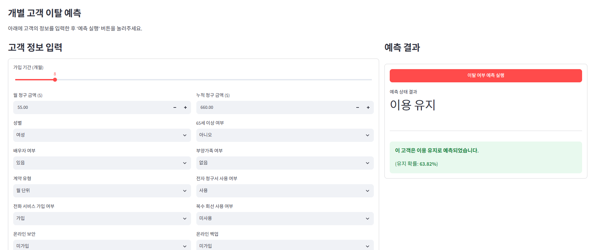
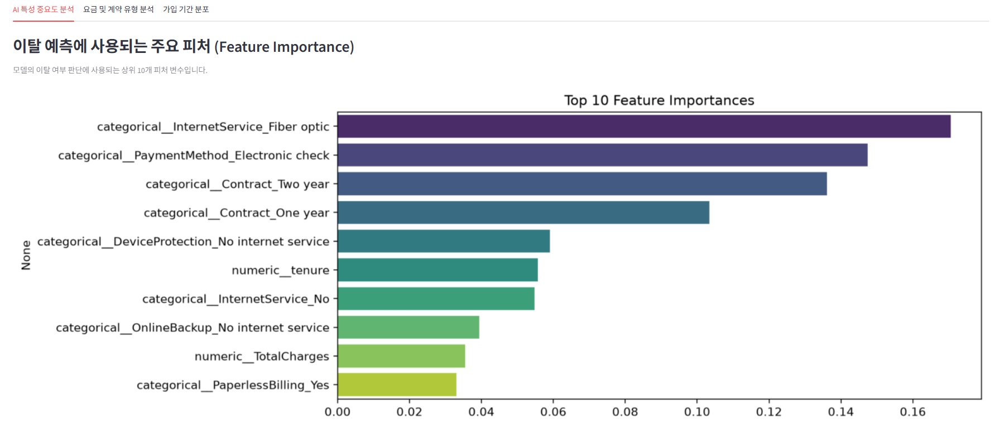

# Telco 고객 이탈 예측 및 모델 개선

통신 고객의 가입 기간, 요금, 계약 및 서비스 정보를 분석하고 **고객 이탈 여부를 예측하는 이진 분류 프로젝트**입니다. 기준 모델을 만든 뒤 파생변수, 클래스 가중치, 하이퍼파라미터 조정의 효과를 동일한 교차검증 조건에서 비교했습니다.

고객 정보를 직접 입력하는 **Streamlit 이탈 위험도 시뮬레이터**와 **데이터 인사이트 대시보드**를 제공합니다.

### ▶ 설치 없이 직접 실행하기

**[Streamlit 시뮬레이터·대시보드 실행하기](https://telco-churn-znwkcae2vy754zuumjr7p4.streamlit.app/)**

브라우저에서 고객 정보를 입력하고 **이탈 여부 예측 실행**을 누르면 결과를 확인할 수 있습니다. **데이터 인사이트 대시보드** 탭에서는 주요 피처와 고객 분포를 살펴볼 수 있습니다.

- 작성자: 김동현
- 최신 분석 및 모델 재학습 기준: [`churn_analysis.ipynb`](churn_analysis.ipynb)
- 공통 학습·평가 함수: [`churn_pipeline.py`](churn_pipeline.py) — 노트북과 CLI가 같은 함수를 사용합니다.
- 앱 실행 파일: [`app.py`](app.py)

**바로 보기:** [시뮬레이터·대시보드 화면](#5-streamlit-기능) · [모델 개선 실험](#3-모델-개선-실험) · [실행 방법](#7-실행-방법)

## 1. 데이터 및 목표

| 항목 | 내용 |
|---|---|
| 데이터 | Telco Customer Churn |
| 규모 | 고객 7,043명, 원본 21개 열 |
| 예측 대상 | `Churn`: 이탈 Yes=1, 유지 No=0 |
| 입력 변수 | 고객 ID와 정답을 제외한 19개 |
| 주요 변수 | `tenure` 가입 개월 수, `MonthlyCharges` 월 요금, `TotalCharges` 누적 요금, 계약·서비스·결제 유형 |
| 전체 이탈 비율 | 26.54% (1,869명) |

데이터 안내: [Kaggle — Telco Customer Churn](https://www.kaggle.com/datasets/blastchar/telco-customer-churn)

목표는 이탈 관련 특성을 살펴보고, 모델 변경 전후의 성능을 비교해 채택·미채택 근거를 기록하는 것입니다. 관찰된 상관관계나 피처 중요도로 실제 해지 원인을 확정하지 않습니다.

## 2. 분석 흐름

1. 데이터 구조, 중복, 결측치 및 변수별 분포 확인
2. Pearson·Spearman 상관관계, 범주별·가입 기간별 이탈률 분석
3. 결측치 대체, 원핫 인코딩, 수치형 표준화
4. 로지스틱 회귀·랜덤 포레스트·XGBoost 기준 모델 비교
5. 파생변수 추가, 변수 제거, 클래스 가중치 및 GridSearchCV 실험
6. 최종 모델 선정 후 테스트 평가, 중요도 분석, 모델 저장·재로딩
7. Streamlit 예측 화면 및 분석 대시보드 구성

### 전처리 및 검증

- `customerID` 제외, `Churn`을 정답으로 분리
- `TotalCharges`의 공백을 숫자로 변환하면서 결측 처리: 전체 11건, 학습 8건
- 수치형 3개: 중앙값 대체 및 StandardScaler
- 범주형 16개: 최빈값 대체 및 OneHotEncoder (`drop='first'`, `handle_unknown='ignore'`)
- `SeniorCitizen`은 범주형으로 처리하고, 서비스 미이용 범주는 유지
- 이상치 후보라는 이유만으로 고객 행을 삭제하지 않음
- 학습 **80% (5,634명)** / 테스트 **20% (1,409명)**, 이탈 비율을 유지하는 계층 분할
- 학습 내부 **계층 3겹 교차검증**, 난수 시드 `42`
- 전처리와 모델을 Pipeline으로 묶어 각 학습 폴드에서만 전처리 기준 학습
- **평균 CV ROC-AUC로 모델을 선정**하고, 판정 임계값은 `0.5` 사용

## 3. 모델 개선 실험

| 실험 | 평균 CV ROC-AUC | 결과 |
|---|---:|---|
| 로지스틱 회귀 기준 모델 | 0.8458 | 비교 기준 |
| 랜덤 포레스트 기준 모델 | 0.8469 | 비교 기준 |
| XGBoost 기준 모델 | 0.8464 | 개선 전 기준 |
| XGBoost 전화 서비스 변수 제거 | 0.8466 | 최종 후보보다 낮아 미채택 |
| XGBoost 가입 기간 구간 추가 | 0.8461 | 미채택 |
| XGBoost 월평균 누적 요금 추가 | 0.8461 | 미채택 |
| XGBoost 요금 차이 추가 | 0.8450 | 미채택 |
| XGBoost 세 파생변수 함께 추가 | 0.8448 | 미채택 |
| 랜덤 포레스트 클래스 가중치 | 0.8476 | 최종 AUC 기준 미선택 |
| 랜덤 포레스트 GridSearchCV | 0.8469 | 기준 설정과 동일 |
| **XGBoost GridSearchCV** | **0.8503** | **최종 선택** |

GridSearchCV에서 랜덤 포레스트 8개, XGBoost 16개 설정 조합을 비교했습니다. 별도로 XGBoost 깊이·트리 수 4조합도 비교했습니다. 최종 모델은 파생변수를 추가하지 않은 원본 입력 19개를 사용합니다.

전체 자동 탐색 결과는 재학습 시 `notebook_tables/RF_GridSearch_results.csv`와 `notebook_tables/XGB_GridSearch_results.csv`로 저장됩니다. 각 설정의 평균·표준편차 AUC, 재현율, F1 및 학습 AUC를 확인할 수 있습니다.

클래스 가중치를 적용한 랜덤 포레스트는 학습 내부 OOF 재현율이 **47.63% → 79.60%**로 높아졌지만 정밀도는 **67.49% → 52.80%**로 낮아졌습니다. 이탈 탐지를 늘리는 것과 오탐을 줄이는 것 사이의 균형을 확인했습니다.

### 최종 XGBoost 주요 설정

| 설정 | 값 |
|---|---:|
| `max_depth` | 2 |
| `n_estimators` | 300 |
| `learning_rate` | 0.03 |
| `reg_lambda` | 5 |
| `subsample` | 0.8 |
| `colsample_bytree` | 0.8 |

## 4. 최종 테스트 결과

저장된 `outputs_80_20/test_metrics.csv` 기준이며, `Selected`는 자동 탐색으로 선정한 XGBoost입니다.

| 모델 | Accuracy | Precision | Recall | F1 | ROC-AUC | AP |
|---|---:|---:|---:|---:|---:|---:|
| LogisticRegression | 0.8055 | 0.6572 | 0.5588 | 0.6040 | 0.8421 | 0.6346 |
| RandomForest | 0.8041 | 0.6801 | 0.4947 | 0.5728 | 0.8452 | 0.6605 |
| XGBoost 기준 모델 | 0.8041 | 0.6633 | 0.5321 | 0.5905 | 0.8450 | 0.6641 |
| **Selected** | **0.7999** | **0.6586** | **0.5107** | **0.5753** | **0.8473** | **0.6644** |

최종 모델은 실제 이탈 고객 374명 중 191명을 탐지하고 183명을 놓쳤습니다. 유지 고객 중 99명을 이탈로 잘못 예측했습니다.

| 실제 / 예측 | 유지 예측 | 이탈 예측 |
|---|---:|---:|
| 실제 유지 | 936 | 99 |
| 실제 이탈 | 183 | 191 |

기준 XGBoost 대비 테스트 AUC는 소폭 높아졌지만 재현율과 F1은 낮아졌습니다. 모든 지표가 함께 개선된 것은 아닙니다. AUC는 정확도와 다른 지표이며, 최종 모델은 테스트 점수로 재선정하지 않았습니다.

## 5. Streamlit 기능

### 이탈 위험도 시뮬레이터

👉 **[배포된 앱에서 직접 예측해 보기](https://telco-churn-znwkcae2vy754zuumjr7p4.streamlit.app/)**



**고객 정보 입력 → 예측 실행 → 판정과 점수 확인**

왼쪽에서 고객 조건을 입력하고 오른쪽에서 결과를 확인합니다. 캡처 예시는 가입 8개월·월 요금 55·누적 요금 660 등의 조건에서 **이용 유지**로 분류된 화면입니다. 표시된 63.82%는 해당 예시의 유지 점수이며 모델 정확도가 아닙니다.

가입 기간, 요금, 계약 및 서비스 정보를 입력하면 저장된 전처리·모델로 이탈 점수를 계산합니다. 점수가 저장된 임계값 `0.5` 이상이면 **이탈 위험**, 미만이면 **이용 유지**로 표시합니다.

현재 앱 코드는 결과를 **예측 점수**로 표시하고, 입력이 제공 데이터의 관측 범위를 벗어나면 안내합니다. 확률 보정은 수행하지 않았으며 실제 미래 행동을 확정하지 않습니다. 위 캡처는 안내 문구를 보완하기 전의 실제 실행 화면입니다.

### 데이터 인사이트 대시보드



**예측 결과와 함께, 모델이 어떤 정보를 활용했는지 확인**

캡처는 피처 중요도 탭입니다. 광인터넷 이용 여부, 전자수표 결제, 계약 유형 등이 상위에 나타납니다. 중요도는 모델이 활용한 정도이며 이탈 증가 방향이나 실제 해지 원인을 의미하지 않습니다. 다른 탭에서는 요금·계약 및 가입 기간별 고객 분포를 확인할 수 있습니다.

- 최종 모델의 피처 중요도 상위 10개
- 유지·이탈 집단의 월 요금 분포
- 계약 유형별 유지·이탈 고객 수
- 가입 기간별 유지·이탈 고객 수의 적층 분포

대시보드의 고객 분포는 전체 CSV 기준입니다. 학습 데이터만으로 작성한 노트북 EDA와 표본 기준이 다르며, 고객 수 그래프를 이탈률로 해석하지 않습니다.

## 6. 폴더 구조

GitHub에 포함한 주요 파일과 폴더입니다.

```text
.
├── README.md
├── .gitignore                       # 업로드할 파일 허용 목록
├── docs/
│   └── images/                      # README용 실제 앱 화면 2장
├── app.py                           # Streamlit 앱
├── churn_analysis.ipynb              # 최신 EDA·개선 실험·평가·모델 저장
├── churn_pipeline.py                 # 노트북·CLI 공통 학습 함수 및 앱 피처 변환
├── requirements.txt                 # 앱·분석 라이브러리
├── packages.txt                     # Linux 배포용 나눔 글꼴
├── WA_Fn-UseC_-Telco-Customer-Churn.csv
├── .streamlit/
│   └── config.toml                   # Streamlit 설정
├── outputs_80_20/
│   ├── selected_model.joblib         # Pipeline·입력 열·변형 방식·임계값
│   ├── selection_before_test.json    # 테스트 평가 전 선정 기록
│   ├── cv_comparison.csv             # 후보별 교차검증 결과
│   ├── cv_oof_predictions.csv        # 학습 내부 검증 예측
│   ├── test_metrics.csv              # 테스트 성능
│   ├── test_predictions.csv          # 테스트 예측값
│   ├── split_membership.csv          # 학습·테스트 분할 기록
│   ├── run_metadata.json             # 실행 환경·데이터 해시·난수 등
│   ├── notebook_figures/             # 최신 노트북 그래프
│   ├── notebook_tables/              # 최신 노트북 표·실험 결과
│   └── ...                          # 순열 중요도·OOF 예측 등 평가 근거
```

실행 명령은 **프로젝트 루트**를 기준으로 합니다. 로컬의 `github_upload/`, `보관/`, `참고자료/`, 보고서 및 이전 안내 문서는 업로드에서 제외했습니다. 최신 분석은 노트북과 결과 CSV를 참고하세요.

## 7. 실행 방법

### 환경 준비

기록된 분석 환경은 Python **3.12.6**, pandas **3.1.0**, scikit-learn **1.9.1**, XGBoost **3.4.1**입니다. 저장된 모델을 사용할 때는 `requirements.txt`의 버전을 맞추는 것을 권장합니다.

처음 다운로드한다면 아래 명령으로 저장소를 받고 프로젝트 폴더로 이동합니다. 아래는 **Windows PowerShell** 기준입니다.

```powershell
git clone https://github.com/Navii112/telco-churn-prediction.git
cd telco-churn-prediction
```

프로젝트 루트에서 가상환경을 만들고 패키지를 설치합니다.

```powershell
python -m venv .venv
.\.venv\Scripts\python.exe -m pip install -r requirements.txt
```

이미 `.venv`가 있다면 생성 명령은 생략합니다. 가상환경을 활성화하지 않아도 아래 명령으로 실행할 수 있습니다.

### A. 저장된 모델로 앱 실행

필요한 파일:

- `app.py`, `churn_pipeline.py`, `requirements.txt`
- `WA_Fn-UseC_-Telco-Customer-Churn.csv`
- `outputs_80_20/selected_model.joblib`
- `.streamlit/config.toml` (현재 앱 설정)

```powershell
.\.venv\Scripts\python.exe -m streamlit run app.py
```

브라우저에서 [http://localhost:8501](http://localhost:8501)에 접속합니다. 종료는 터미널에서 `Ctrl+C`를 누릅니다. 모델 파일이 이미 있으면 노트북을 다시 학습하지 않고 앱을 실행할 수 있습니다.

### B. 노트북 분석 및 최신 모델 재학습

`requirements.txt`에는 Jupyter 실행 도구가 포함되어 있지 않으므로 별도로 설치합니다.

```powershell
.\.venv\Scripts\python.exe -m pip install jupyterlab ipykernel
.\.venv\Scripts\python.exe -m ipykernel install --user --name telco-churn --display-name "Python (Telco Churn)"
.\.venv\Scripts\python.exe -m jupyterlab
```

1. 프로젝트 루트에서 JupyterLab을 실행하고 `churn_analysis.ipynb`를 엽니다.
2. 커널을 `Python (Telco Churn)`으로 선택합니다.
3. 의존성을 이미 설치했다면 첫 `%pip install` 셀은 생략할 수 있습니다.
4. 나머지 셀을 위에서부터 순서대로 실행합니다.

VS Code에서도 해당 노트북을 열고 같은 가상환경 커널을 선택해 실행할 수 있습니다.

노트북은 현재 작업 폴더를 기준으로 CSV를 읽고 `outputs_80_20/`에 결과를 저장합니다. 전체 실행 시 기존 결과 표·그림·저장 모델이 갱신됩니다. 학습 모델을 갱신한 뒤에는 Streamlit을 종료하고 다시 실행해 캐시된 모델도 새로 불러오세요.

### C. CLI로 같은 모델 실험 재현하기

노트북과 CLI는 `churn_pipeline.py`의 공통 전처리·학습·평가 함수를 사용합니다. CLI도 개별·통합 파생변수, 클래스 가중치, 수동 설정 및 GridSearchCV를 같은 조건으로 비교합니다. EDA 그래프와 단계별 설명은 노트북에서 확인합니다.

기존 제출 결과를 보존하도록 CLI 기본 출력 폴더는 `outputs_cli/`로 분리했습니다.

```powershell
.\.venv\Scripts\python.exe churn_pipeline.py --out outputs_cli
```

이 명령은 별도 결과 폴더를 생성하며 앱이 읽는 모델 경로는 변경하지 않습니다. 자동 탐색 전체 설정 결과도 해당 폴더의 `notebook_tables/`에 저장합니다. `--out outputs_80_20`을 직접 지정하면 기존 결과가 갱신됩니다.

### Streamlit Community Cloud 배포

이 저장소로 배포할 때는 브랜치 `main`, 실행 파일 `app.py`, Python `3.12`를 선택합니다. `requirements.txt`는 Python 패키지를, `packages.txt`는 Linux용 `fonts-nanum`을 설치합니다. 앱은 설치된 나눔 글꼴을 등록해 그래프에 사용합니다. [Streamlit 의존성 안내](https://docs.streamlit.io/deploy/streamlit-community-cloud/deploy-your-app/app-dependencies)

기존 배포 앱이 다른 저장소에 연결되어 있다면 이 저장소의 변경 사항은 자동 반영되지 않습니다. 배포 설정의 연결 저장소를 확인해야 합니다.

### 실행 시 확인할 사항

- **모델 파일을 찾을 수 없음:** `outputs_80_20/selected_model.joblib`을 준비하거나 노트북을 끝까지 실행합니다.
- **CSV를 찾을 수 없음:** 파일명이 일치하는지, 프로젝트 루트에서 실행했는지 확인합니다.
- **한글 그래프 글꼴:** Windows에서는 `Malgun Gothic`, Cloud Linux에서는 `packages.txt`로 설치한 `NanumGothic`을 사용합니다. 다른 Linux 환경에서는 나눔 글꼴을 별도로 설치하세요.

## 8. GitHub에 포함할 파일

이 프로젝트는 루트 폴더에서 Git을 사용하는 것을 기준으로 `.gitignore`를 구성했습니다. 필요한 파일만 허용하는 방식이므로 새 파일을 공개하려면 허용 목록에도 추가해야 합니다.

| 구분 | 포함 파일 |
|---|---|
| 소개·코드 | `README.md`, `.gitignore`, `app.py`, `churn_pipeline.py`, `churn_analysis.ipynb`, `requirements.txt` |
| 데이터·설정 | 원본 CSV, `.streamlit/config.toml`, `packages.txt` |
| 앱용 모델 | `outputs_80_20/selected_model.joblib` |
| 앱 화면 | `docs/images/churn-simulator.png`, `docs/images/insight-dashboard.png` |
| 평가 근거 | CV·테스트 결과, 예측값, 분할 기록, 선정 기록, 실행 메타데이터 |
| 시각화·상세 표 | `outputs_80_20/notebook_figures/*.png`, `outputs_80_20/notebook_tables/*.csv` 및 실행 그림 목록 |

`.venv`, 캐시, `github_upload/` 사본, `보관/`, `참고자료/`, 한글 보고서, 이전 PDF·그림·안내 문서, 비밀 설정은 제외합니다. 로컬 파일은 삭제되지 않습니다.

GitHub 업로드 전 프로젝트 루트에서 포함 목록을 확인할 수 있습니다.

```powershell
git init
git add --dry-run .
```

`.gitignore`는 Git 명령에 적용됩니다. 브라우저에서 파일을 직접 드래그해 업로드할 때는 제외 규칙이 자동 적용되지 않습니다.

## 9. 한계 및 향후 개선

- 단일 공개 데이터의 결과이며 실제 서비스의 미래 고객 성능을 보장하지 않습니다.
- 같은 교차검증으로 여러 후보를 비교했으므로 선택 편향 가능성이 있습니다. 테스트 분할도 이전 실험과 같아 새로운 독립 검증을 대체하지 않습니다.
- 임계값 `0.5`에서 실제 이탈 고객의 약 절반을 놓쳤습니다. 상담 가능 인원과 오탐·미탐 비용을 반영한 임계값 조정을 검토할 수 있습니다.
- 확률 보정, 외부·시간 기준 검증, 고객 유지 정책의 효과 검증은 후속 과제입니다.
- 피처 중요도는 예측에 활용한 정도이며 실제 이탈 원인이나 정책의 효과를 증명하지 않습니다.

## 10. 배운 점

파생변수를 추가하거나 모델을 복잡하게 만든다고 항상 성능이 좋아지지는 않았습니다. 같은 조건에서 변경 전후를 비교하고, 성능이 낮아진 실험도 기록하는 과정이 중요했습니다. 또한 이탈 고객을 더 많이 찾는 것과 정확하게 지목하는 것 사이의 균형을 확인했습니다.

## 11. 출처 및 재사용 안내

데이터 출처는 앞서 연결한 Kaggle의 Telco Customer Churn 페이지입니다. 데이터의 이용 조건은 원본 배포 페이지에서 확인하세요. 코드 라이선스는 아직 별도로 지정하지 않았습니다.
